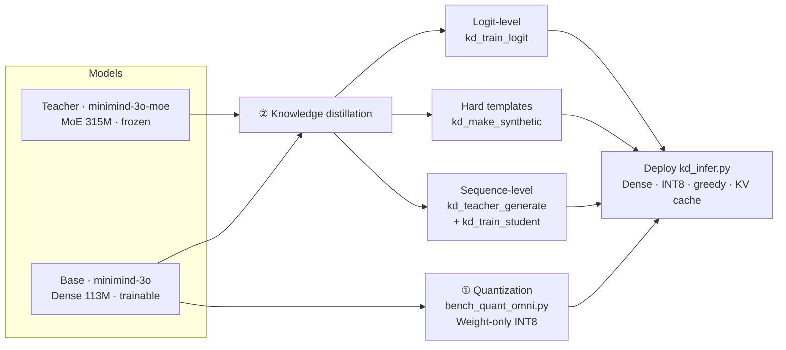
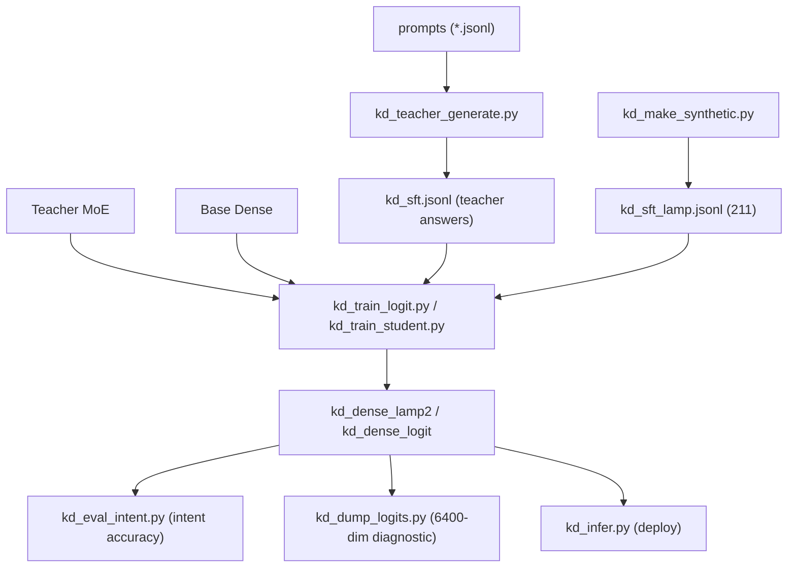
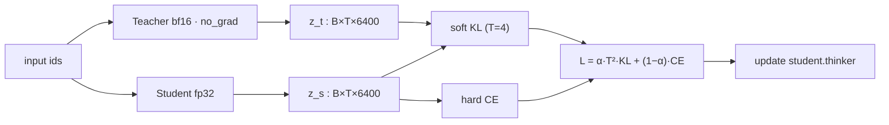
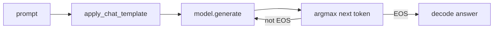

# MiniMind Compression: Weight-only INT8 Quantization + Knowledge Distillation (MoE → Dense)

> 中文说明（面向中文学生）：[**readme_cn.md**](readme_cn.md)
>
> This repository adds two capabilities that the official [MiniMind / MiniMind-O](https://github.com/jingyaogong/minimind) does **not** ship:
> ① a **Weight-only INT8 quantization** benchmark (it even runs on older Pascal GPUs without INT8 Tensor Cores);
> ② a complete **knowledge-distillation** pipeline — sequence-level KD, self-built template hard labels, logit-level soft-label KD, and a real 6400-dim distribution diagnostic.
>
> Use case: **LeLamp smart desk lamp**, an edge model for 15 classes of English voice commands.

---

## Table of Contents

- [1. Background](#1-background)
- [2. Features](#2-features)
- [3. Repository Layout](#3-repository-layout)
- [4. Environment & Install](#4-environment--install)
- [5. Quick Start](#5-quick-start)
- [6. Test Results (real numbers)](#6-test-results-real-numbers)
- [7. Key Takeaways & Lessons](#7-key-takeaways--lessons)
- [8. Tutorial Documents](#8-tutorial-documents)
- [9. FAQ](#9-faq)
- [10. Credits & License](#10-credits--license)

---

## 1. Background

MiniMind-O provides two text (Thinker) models:

| Model | Architecture | Parameters | Role |
|---|---|---|---|
| `minimind-3o-moe` | MoE — 4 FFN experts per layer + a Router, top-1 routing | **314.89M** | **Teacher** (larger, better) |
| `minimind-3o` | Dense — 1 FFN per layer | **113.13M** (63.91M trainable in Thinker) | **Student / edge base** |

They share the same tokenizer and **vocab V = 6400**; hidden size = 768, 8 Thinker layers, GQA (8 Q heads / 4 KV heads / head_dim 96), tied word embeddings.

Deploying a 315M model's capability into a 113M model requires two things: **shrinking the model** (quantization) and **transferring the capability** (distillation). This repo gives a reproducible engineering pipeline plus teaching material.

> **Model weights are NOT committed to this repo** (a single file over 100 MB is rejected by GitHub; the student checkpoint is ~432 MB):
>
> | Weight | Where to get it |
> |---|---|
> | Base / teacher (`minimind-3o`, `minimind-3o-moe`) | Official [MiniMind](https://github.com/jingyaogong/minimind) project (download separately) |
> | **Trained student checkpoint** `thinker_sft_state.pth` (~432 MB, fp32 `state_dict` of the distilled student Thinker — the 75.5% intent-accuracy model) | **[Google Drive download](https://drive.google.com/file/d/1lBcYu1aInIYfYLa47g4f3kWsvKrQUgAC/view?usp=sharing)** |
>
> To use the downloaded checkpoint, place `thinker_sft_state.pth` into the student output directory (e.g. `./kd_dense_lamp2/`, the `--out_dir` of `kd_train_student.py`, which already contains the `save_pretrained` HF files such as `config.json` / tokenizer), then run `kd_infer.py --model_dir ./kd_dense_lamp2`.

---

## 2. Features

### 2.1 Weight-only INT8 quantization benchmark

- `bench_quant_omni.py` runs the **FP32 baseline** and **INT8 weights (FP32 compute)** on the same model, greedily decoding the same fixed questions, and compares:
  - weight size, peak memory, decode speed (tok/s), answer-consistency / similarity;
  - writes `quant_report.md` / `.csv`.
- A custom `W8Linear` stores weights as 8-bit and de-quantizes them back to FP32 at the forward pass — **no bitsandbytes / GPTQ / AWQ kernels required**, so it works on Pascal (GTX1070, sm_61, no INT8 Tensor Cores) and on CPU.
- `--scope blocks` (quantize attention + FFN, maximum compression) or `--scope ffn` (FFN only, safer); for MoE the Router gates are automatically kept in FP32.

### 2.2 Sequence-level (response-level) KD

- The MoE teacher answers a batch of prompts offline; those answers are then used as targets for plain-text SFT of the Dense student.
- Supports resume and teacher-answer quality filtering (`--drop_truncated` / `--min_answer_len`).

### 2.3 Self-built template hard labels

- `kd_make_synthetic.py` encodes 15 lamp intents: many prompts × fixed short replies, `random.choice` with a fixed seed, dedup by user text and shuffle, output as conversations JSONL.
- Generalization comes from **more independent paraphrased prompts**, not from repeating samples.

### 2.4 Logit-level soft-label KD

- `kd_train_logit.py`: the teacher runs online (bf16, frozen, no_grad) and produces `[B, T, 6400]` soft targets; the student runs in fp32 and produces same-shaped logits.
- The loss is computed only on the answer span:
  ```
  L = α · T² · KL( softmax(z_t / T) ‖ softmax(z_s / T) )  +  (1 − α) · CE
  ```
- Output alignment: both `lm_head`s are 768 → 6400 over the same vocab, so **distillation works even though the internal MoE / Dense architectures differ**.

### 2.5 Real distribution diagnostic & deployment inference

- `kd_dump_logits.py` prints, at a specific teacher-forced position, the real logits (first 8 coordinates, words of interest, top-K for T=1 / T=4), the KL, and three-way greedy generation; it can also export the full 6400-row CSV.
- `kd_eval_intent.py` judges intent by substring keyword rules and reports per-class and overall intent accuracy (the metric is aligned to the product goal).
- `kd_infer.py` loads only the student; single-query / interactive mode, temperature=0 greedy, autoregressive + KV-cache inference.

### 2.6 Code architecture & flow diagrams

**Figure 1 — Overall compression & distillation pipeline (two paths → final deployment)**



**Figure 2 — Distillation data flow (scripts → data → training → eval/deploy)**



**Figure 3 — One logit-level training step (KL at the aligned output)**



**Figure 4 — Autoregressive inference (greedy + KV cache)**



---

## 3. Repository Layout

```
minimind-compress/
├── README.md / readme_cn.md
├── requirements.txt
├── .gitignore
│
├── quantization/                     # ① Quantization
│   ├── bench_quant_omni.py
│   └── README.md
│
├── distillation/                     # ② Knowledge distillation
│   ├── kd_common.py                  # shared utils: load model / greedy generate / read prompts
│   ├── kd_teacher_generate.py        # teacher offline batch generation (sequence-level)
│   ├── kd_make_synthetic.py          # template hard-label data generator
│   ├── kd_train_student.py           # student plain-text SFT (hard labels)
│   ├── kd_train_logit.py             # logit-level soft-label KD
│   ├── kd_eval.py                    # similarity-to-teacher eval (early)
│   ├── kd_eval_intent.py             # intent-accuracy eval (recommended)
│   ├── kd_dump_logits.py             # real 6400-dim distribution diagnostic
│   ├── kd_infer.py                   # deployment inference
│   ├── data/
│   │   ├── kd_prompts_seed.jsonl         # 50 seed prompts
│   │   ├── kd_prompts_lamp.jsonl         # 348 lamp prompts
│   │   ├── kd_eval_prompts.jsonl         # 10 general eval prompts
│   │   ├── kd_eval_prompts_lamp.jsonl    # 24 lamp eval prompts
│   │   └── kd_eval_intents.jsonl         # 53 held-out intent prompts (labeled)
│   └── ref/                          # original MiniMind source (needed to load models)
│       ├── model_omni.py
│       └── train_sft_omni.py
│
└── docs/                             # self-contained teaching HTML (open in a browser)
    ├── quantization/
    └── distillation/
```

> `kd_sft_lamp.jsonl` (the 211 training examples) is generated by running `kd_make_synthetic.py` and is not pre-shipped.
> All `kd_dense*`, `*.pth`, `*.safetensors`, `quant_report*`, and `kd_dump_logits*` files are run artifacts and are **not committed**.

---

## 4. Environment & Install

```bash
# A dedicated environment is recommended
conda create -n minimind-compress python=3.12 -y
conda activate minimind-compress

# Common dependencies
pip install torch
pip install transformers==4.57.6 "huggingface-hub>=0.34,<1.0"
pip install datasets numpy safetensors sentencepiece
# Quantization / export
pip install onnxruntime
```

- **Older NVIDIA GPUs (Pascal, GTX1070 / sm_61)**: PyTorch must use the **cu126** channel (cu130 drops sm_61):
  ```bash
  pip install torch==2.14.1 --index-url https://download.pytorch.org/whl/cu126
  ```
- Text-only quantization / KD does **not** load SenseVoice / SigLIP / Mimi and needs no audio / image data.
- Place the scripts under MiniMind's `minimind-o/scripts/` directory, make sure `minimind-3o/` and `minimind-3o-moe/` exist there, and **run from the `scripts/` directory**.

---

## 5. Quick Start

> Commands are **single lines** — copy each as one line (do not use `\` line continuations, which the terminal may swallow).

### 5.1 Weight-only INT8 quantization

```bash
# Smoke test first (8 questions)
python bench_quant_omni.py --model_dir ./minimind-3o --limit 8

# Full 50 questions: quantize attention + FFN (maximum compression)
python bench_quant_omni.py --model_dir ./minimind-3o --limit 50 --scope blocks

# Same for MoE (Router gates automatically kept in FP32)
python bench_quant_omni.py --model_dir ./minimind-3o-moe --limit 50 --scope blocks

# More conservative: FFN only (use if blocks degrades)
python bench_quant_omni.py --model_dir ./minimind-3o --limit 50 --scope ffn
```

### 5.2 Template hard labels + plain-hard SFT

```bash
# Generate the 211 template examples
python kd_make_synthetic.py --out kd_sft_lamp.jsonl

# Student hard-label SFT (best command-domain model)
python kd_train_student.py --student_dir ./minimind-3o --data kd_sft_lamp.jsonl --out_dir ./kd_dense_lamp2 --epochs 3 --batch_size 8 --lr 1e-4 --max_seq_len 384 --device cuda
```

### 5.3 Logit-level soft-label KD

```bash
python kd_train_logit.py --teacher_dir ./minimind-3o-moe --student_dir ./minimind-3o --data kd_sft_lamp.jsonl --out_dir ./kd_dense_logit --epochs 3 --batch_size 4 --temperature 4.0 --alpha 0.3 --device cuda
```

### 5.4 Evaluation (intent accuracy)

```bash
python kd_eval_intent.py --base_dir ./minimind-3o --student_dir ./kd_dense_lamp2 --prompts kd_eval_intents.jsonl --max_new_tokens 128 --device cuda
```

### 5.5 Real distribution diagnostic

```bash
python kd_dump_logits.py --teacher_dir ./minimind-3o-moe --base_dir ./minimind-3o --student_dir ./kd_dense_logit --prompt "Turn on the light." --answer "Sure, I'll turn on the light." --target_word on --temperature 4.0 --device cuda
```

### 5.6 Deployment inference

```bash
# Single query
python kd_infer.py --model_dir ./kd_dense_lamp2 --prompt "Turn on the light." --device cuda

# Interactive mode (omit --prompt)
python kd_infer.py --model_dir ./kd_dense_lamp2 --device cuda
```

---

## 6. Test Results (real numbers)

### 6.1 Quantization

| Metric | FP32 | Weight-only INT8 |
|---|---|---|
| Model size (approx.) | 452 MB | **207 MB** |
| Parameter count | unchanged | unchanged (storage precision 16 → 8-bit only) |
| Peak memory | baseline | reduced |
| Answer consistency | — | very high under greedy decoding (similarity > 0.95 acceptable) |

> The size reduction comes from bits per parameter; the **parameter count is unchanged**. If `--scope blocks` degrades, fall back to `--scope ffn`.

### 6.2 Knowledge distillation (15 lamp intents, 53 held-out questions)

| Approach | Data | Intent accuracy |
|---|---|---|
| Untrained base | — | 22.6% |
| Hard labels | 98 templates | 56.6% |
| **Hard labels (final choice)** | **211 templates** | **75.5%** |
| Logit soft labels (T=4, α=0.3) | 211 | 64.2% |

### 6.3 Per-position KL divergence (T=4; lower = more like the teacher)

| Example | Base (before) | KD (after) |
|---|---|---|
| `"Turn on the light"` (target on) | 0.2774 | **0.1017** |
| `"Thank you"` (target 're) | 0.3240 | **0.1779** |
| `"Tell me a joke"` (target did) | 0.4058 | **0.2598** |

> The mechanism is correct: KL drops at all three positions. Yet the command-domain total accuracy drops — showing the **soft labels conflict with hard labels on that task** (see below).

### 6.4 Actual generation effects (real samples)

| Input | Model | Actual output |
|---|---|---|
| `"Turn on the light."` | Teacher (free generation) | **Evasive / hedging**: "It seems like… / Could you clarify…" (teacher ceiling) |
| `"Turn on the light."` | **Distilled student (deployed)** | `"Sure, I'll turn on the light."` (correct) |
| `"Tell me a joke."` | Teacher / untrained base | `"Why don't scientists trust atoms? Because they make up everything!"` |
| `"Tell me a joke."` | Hard-template student (KD) | `"Sure, here's a light-hearted joke."` (open domain made conservative) |
| `"Thank you."` | Teacher / base | `"You're welcome! How can I assist you today?"` |
| `"Thank you."` | Hard-template student (KD) | `"Happy to help."` (matches the thanks intent) |

**How to read this**: in the command domain the teacher hedges but the **distilled student executes correctly** (thanks to hard labels); in the open domain hard labels make the student stop at a preamble, where soft labels (α≈0.7) should be used. This is the direct evidence for the **"hard for commands, soft for chat"** per-domain strategy.

---

## 7. Key Takeaways & Lessons

1. **Do not confuse the three "shrinking" effects**:
   - 315M → 113M comes from **architecture choice** (MoE 4 experts → Dense 1 FFN);
   - 452MB → 207MB comes from **INT8 quantization** (parameter count unchanged);
   - speedups come from **ONNX / KV cache**;
   - **KD itself does not change model size** — it only transfers capability.
2. **Evaluate the teacher before trusting soft labels**. On commands the teacher hedges during **free generation** ("It seems like… / Could you clarify…"), a clear "teacher ceiling"; under teacher forcing it is correct at mid-span fill-in positions — the evasion happens only at the free-generation opening position.
3. **Hard labels for deterministic tasks, soft labels for open / style tasks**:
   - command control: hard templates are best (75.5%), α should be small / zero;
   - chat / jokes: soft labels are more natural, α ≈ 0.7.
4. **Generalization comes from input-expression diversity, not repetition**: `--repeat` only adds reply diversity, not prompt coverage; write many independent paraphrases with zero overlap with the held-out set.
5. **The evaluation metric must match the product goal**: for intent tasks use "intent keyword substring match," not "similarity to the teacher," and not perplexity alone.
6. **Training details**: teacher bf16 forward, convert logits to fp32 for the KL; train the student in fp32; use the teacher as the target (`F.kl_div(log_softmax(s/T), softmax(t/T))`) and multiply by **T²**; optimize only `student.thinker`.

---

## 8. Tutorial Documents

The `docs/` folder contains self-contained HTML (inline CSS/JS, opens in a browser, no network needed):

**Quantization**
- `weight_only_int8_rtn_explained.html`: Weight-only INT8 / RTN principles
- `bench_quant_flowchart.html`: quantization benchmark flow
- `quantization_distillation_roadmap.html`: overall quantization + KD roadmap

**Distillation**
- `kd_big_picture.html`: the big picture of KD
- `kd_teacher_filtering.html`: teacher-answer quality filtering
- `kd_three_commands_explained.html`: three core commands
- `代码讲解.html` / `kd_code_walkthrough.html`: line-by-line code walkthrough
- `kd_smoke_results_and_code.html`: smoke results and code
- `logit级蒸馏讲解.html`: logit-level KD principles
- `logit级蒸馏详解_真实数据与推理.html`: real data + mixed loss + inference
- `LeLamp知识蒸馏项目复盘与面试手册.html`: project retrospective + 17 interview Q&As

---

## 9. FAQ

- **`no kernel image is available for execution on the device`**: torch is the cu130 / CPU build; on older Pascal GPUs reinstall the cu126 wheel.
- **CLI reports `unrecognized arguments`**: the `\` was swallowed on paste; copy each command as a single line.
- **`model.generate` returns None**: non-stream mode returns an audio frame at the end; use `stream=True` and take the last non-None y, or `return_audio_codes=False` for text only.
- **The script loads SenseVoice / SigLIP**: you are not in the `scripts/` directory or `./model` exists; return to `scripts/` for text tasks.
- **`torch_dtype is deprecated`**: a cosmetic warning from transformers 4.57; it does not affect execution.

---

## 10. Credits & License

- This project is a hands-on extension built on [MiniMind](https://github.com/jingyaogong/minimind) by jingyaogong. **The model weights and original modeling code belong to the original author** and follow their open-source license; download the models separately from the official channels — this repo ships no weights.
- The new scripts, data, and tutorials added here are released under your chosen open-source license (MIT / Apache-2.0 recommended).
- For learning and teaching purposes only; no commercial warranty.

> If you find this project useful, please give it a Star, and feel free to open an Issue to discuss edge deployment and distillation.
#（注：内容由AI生成）
