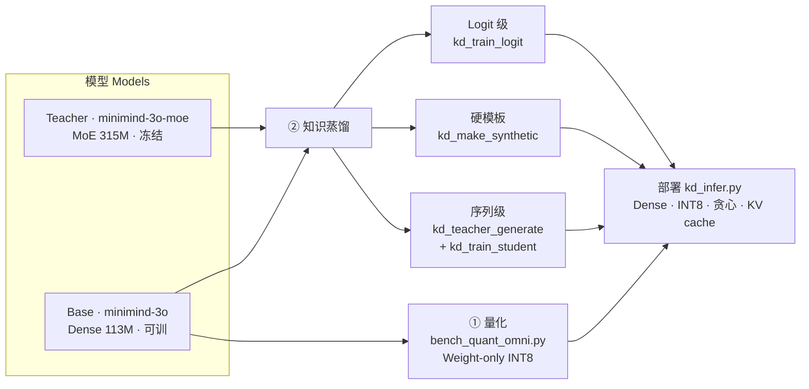
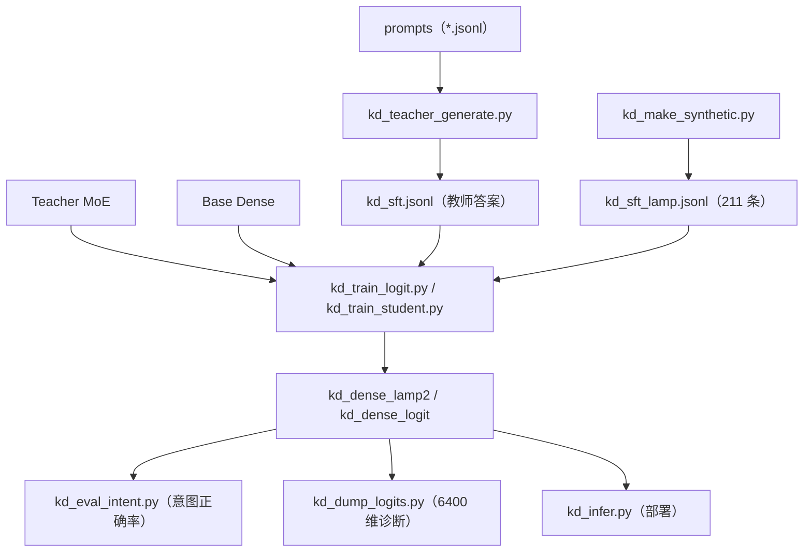
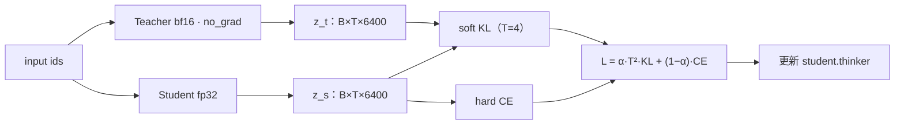
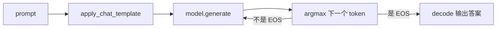

# MiniMind 模型压缩实践：Weight-only INT8 量化 + 知识蒸馏（MoE → Dense）

> 在 [MiniMind / MiniMind-O](https://github.com/jingyaogong/minimind) 之上，补齐官方仓库**没有提供**的两块能力：
> ① **Weight-only INT8 量化**基准（在没有 INT8 Tensor Core 的 Pascal 老显卡上也能跑）；
> ② **知识蒸馏**完整链路：序列级蒸馏、自建模板硬标签、Logit 级软标签蒸馏，以及真实 6400 维分布诊断。
>
> 应用场景：**LeLamp 智能台灯**（英文 15 类语音指令的端侧小模型）。
>
> English version: see [README.md](README.md)（如需可另行提供）。

---

## 目录

- [一、项目背景](#一项目背景)
- [二、功能特性](#二功能特性)
- [三、仓库结构](#三仓库结构)
- [四、环境与安装](#四环境与安装)
- [五、快速开始](#五快速开始)
- [六、实验结果（真实数据）](#六实验结果真实数据)
- [七、核心结论与经验](#七核心结论与经验)
- [八、教学文档索引](#八教学文档索引)
- [九、常见问题](#九常见问题)
- [十、致谢与许可](#十致谢与许可)

---

## 一、项目背景

MiniMind-O 提供了两种文本（Thinker）模型：

| 模型 | 结构 | 参数量 | 说明 |
|---|---|---|---|
| `minimind-3o-moe` | MoE，每层 4 个 FFN 专家 + Router，top-1 路由 | **314.89M** | 容量大、质量好，作为**教师** |
| `minimind-3o` | Dense，每层 1 个 FFN | **113.13M**（Thinker 可训 63.91M） | 体量小、行为确定，作为**学生 / 端侧基座** |

两者共享同一套 tokenizer，**词表 V = 6400**，hidden = 768，Thinker 8 层，GQA（8 Q 头 / 4 KV 头 / head_dim 96），tie word embeddings。

要把 315M 的能力塞进 113M 并部署到端侧，需要解决两件事：**模型变小**（量化）和**能力迁移**（蒸馏）。本项目给出了一套可复现的工程链路与教学文档。

> **说明：模型权重不入库**（GitHub 单文件超过 100 MB 会被拒绝，学生 checkpoint 约 432 MB）：
>
> | 权重 | 获取方式 |
> |---|---|
> | 基座 / 教师（`minimind-3o`、`minimind-3o-moe`） | 从 [MiniMind](https://github.com/jingyaogong/minimind) 官方仓库单独下载 |
> | **蒸馏学生 checkpoint** `thinker_sft_state.pth`（约 432 MB，蒸馏后学生 Thinker 的 fp32 `state_dict`，即意图正确率 75.5% 的模型） | **[Google Drive 下载](https://drive.google.com/file/d/1lBcYu1aInIYfYLa47g4f3kWsvKrQUgAC/view?usp=sharing)** |
>
> 下载后把 `thinker_sft_state.pth` 放到学生输出目录（如 `./kd_dense_lamp2/`，即 `kd_train_student.py` 的 `--out_dir`，里面已有 `save_pretrained` 的 HF 文件如 `config.json` / tokenizer），再运行 `kd_infer.py --model_dir ./kd_dense_lamp2` 即可推理。

---

## 二、功能特性

### 1. Weight-only INT8 量化基准

- 脚本 `bench_quant_omni.py`：同一模型分别跑 **FP32 基线** 与 **INT8 权重（FP32 计算）**，用相同固定问题贪心解码，对比：
  - 权重体积、峰值显存、解码速度（tok/s）、答案一致率 / 相似度；
  - 输出 `quant_report.md` / `.csv`。
- 自定义 `W8Linear`：把 `nn.Linear` 权重按 8bit 存储，前向时反量化回 FP32 做普通矩阵乘——**不依赖 bitsandbytes / GPTQ / AWQ 新内核**，在 Pascal（GTX1070，sm_61，无 INT8 Tensor Core）和 CPU 上都能跑。
- 支持 `--scope blocks`（量化注意力 + FFN，压缩最大）/ `--scope ffn`（只量化 FFN，更稳），MoE 自动保留 Router gate 为 FP32。

### 2. 序列级知识蒸馏（Response-level KD）

- 教师 MoE 离线对一批 prompt 生成答案，再把这些答案当目标，对学生 Dense 做纯文本 SFT。
- 支持断点续跑、教师答案质量过滤（`--drop_truncated` / `--min_answer_len`）。

### 3. 自建模板硬标签（确定性命令任务）

- `kd_make_synthetic.py`：内置 15 类台灯意图，多 prompt × 固定短回复，`random.choice` + 固定 seed，按 user 去重并 shuffle，输出 conversations JSONL。
- 泛化靠**更多独立的同义改写 prompt**，而非重复样本。

### 4. Logit 级软标签蒸馏（Logit-level KD）

- `kd_train_logit.py`：教师在线（bf16、冻结、no_grad）输出 `[B, T, 6400]` 软目标，学生 fp32 输出同维 logits；
- 只在回答段做损失：
  ```
  L = α · T² · KL( softmax(z_t / T) ‖ softmax(z_s / T) )  +  (1 − α) · CE
  ```
- 出口对齐：两者 `lm_head` 都是 768 → 6400、同一词表，因此**内部 MoE / Dense 结构不同也能蒸馏**。

### 5. 真实分布诊断与部署推理

- `kd_dump_logits.py`：对具体 teacher-forced 位置打印真实 logits（前 8 坐标、关心词、top-K 含 T=1 / T=4）、KL、三方贪心生成，并可导出完整 6400 行 CSV。
- `kd_eval_intent.py`：按意图关键短语做子串判定，输出每类与总意图正确率（评测对齐产品目标）。
- `kd_infer.py`：只载学生，单条 / 交互模式，temperature=0 贪心，自回归 + KV cache 推理。

### 6. 代码思路与架构图（GitHub 会直接渲染下面的 Mermaid 图）

**图 1：整体压缩与蒸馏流水线（两条路径 → 最终部署）**



**图 2：蒸馏代码数据流（脚本 → 数据 → 训练 → 评测/部署）**



**图 3：Logit 级训练单步（出口对齐做 KL）**



**图 4：推理时自回归（贪心 + KV cache）**



---

## 三、仓库结构

```
minimind-compress/
├── README.md / readme_cn.md
├── requirements.txt
├── .gitignore
│
├── quantization/                     # ① 量化
│   ├── bench_quant_omni.py
│   └── README.md
│
├── distillation/                     # ② 知识蒸馏
│   ├── kd_common.py                  # 公共工具：加载模型 / 贪心生成 / 读 prompt
│   ├── kd_teacher_generate.py        # 教师离线批量生成答案（序列级）
│   ├── kd_make_synthetic.py          # 生成模板硬标签数据
│   ├── kd_train_student.py           # 学生纯文本 SFT（硬标签）
│   ├── kd_train_logit.py             # Logit 级软标签蒸馏
│   ├── kd_eval.py                    # 与教师相似度评测（早期）
│   ├── kd_eval_intent.py             # 意图正确率评测（推荐）
│   ├── kd_dump_logits.py             # 真实 6400 维分布诊断
│   ├── kd_infer.py                   # 部署推理
│   ├── data/
│   │   ├── kd_prompts_seed.jsonl         # 50 条种子 prompt
│   │   ├── kd_prompts_lamp.jsonl         # 348 条台灯 prompt
│   │   ├── kd_eval_prompts.jsonl         # 10 条通用评测
│   │   ├── kd_eval_prompts_lamp.jsonl    # 24 条台灯评测
│   │   └── kd_eval_intents.jsonl         # 53 条意图留出集（带 intent 标注）
│   └── ref/                          # MiniMind 原始源码（加载模型所需，供参考）
│       ├── model_omni.py
│       └── train_sft_omni.py
│
└── docs/                             # 自包含教学 HTML（浏览器直接打开）
    ├── quantization/
    └── distillation/
```

> 注意：`kd_sft_lamp.jsonl`（211 条训练数据）由 `kd_make_synthetic.py` 运行生成，不随仓库预置；
> 所有 `kd_dense*`、`*.pth`、`*.safetensors`、`quant_report*`、`kd_dump_logits*` 均为运行产物，**不入库**。

---

## 四、环境与安装

```bash
# 建议新建独立环境
conda create -n minimind-compress python=3.12 -y
conda activate minimind-compress

# 通用依赖
pip install torch
pip install transformers==4.57.6 "huggingface-hub>=0.34,<1.0"
pip install datasets numpy safetensors sentencepiece
# 量化 / 导出相关
pip install onnxruntime
```

- **NVIDIA 老显卡（Pascal，GTX1070 / sm_61）**：PyTorch 必须走 **cu126** 通道（cu130 已删除 sm_61）：
  ```bash
  pip install torch==2.14.1 --index-url https://download.pytorch.org/whl/cu126
  ```
- 纯文本量化 / 蒸馏**不加载** SenseVoice / SigLIP / Mimi，也不需要音频 / 图像数据。
- 请把脚本放到 MiniMind 的 `minimind-o/scripts/` 目录下，并确保该目录存在 `minimind-3o/`、`minimind-3o-moe/` 两个模型目录，**从 `scripts/` 目录运行**。

---

## 五、快速开始

> 以下命令均为**单行**，请整行复制（不要使用 `\` 续行，避免终端吞字符）。

### 1. Weight-only INT8 量化

```bash
# 先冒烟（8 问）
python bench_quant_omni.py --model_dir ./minimind-3o --limit 8

# 正式 50 问：量化注意力 + FFN（压缩最大）
python bench_quant_omni.py --model_dir ./minimind-3o --limit 50 --scope blocks

# MoE 同法（自动保留 Router gate 为 FP32）
python bench_quant_omni.py --model_dir ./minimind-3o-moe --limit 50 --scope blocks

# 更保守：只量化 FFN（blocks 掉点时用）
python bench_quant_omni.py --model_dir ./minimind-3o --limit 50 --scope ffn
```

### 2. 生成模板硬标签 + 纯硬 SFT

```bash
# 生成 211 条模板数据
python kd_make_synthetic.py --out kd_sft_lamp.jsonl

# 学生纯硬标签 SFT（命令域最佳模型）
python kd_train_student.py --student_dir ./minimind-3o --data kd_sft_lamp.jsonl --out_dir ./kd_dense_lamp2 --epochs 3 --batch_size 8 --lr 1e-4 --max_seq_len 384 --device cuda
```

### 3. Logit 级软标签蒸馏

```bash
python kd_train_logit.py --teacher_dir ./minimind-3o-moe --student_dir ./minimind-3o --data kd_sft_lamp.jsonl --out_dir ./kd_dense_logit --epochs 3 --batch_size 4 --temperature 4.0 --alpha 0.3 --device cuda
```

### 4. 评测（意图正确率）

```bash
python kd_eval_intent.py --base_dir ./minimind-3o --student_dir ./kd_dense_lamp2 --prompts kd_eval_intents.jsonl --max_new_tokens 128 --device cuda
```

### 5. 真实分布诊断

```bash
python kd_dump_logits.py --teacher_dir ./minimind-3o-moe --base_dir ./minimind-3o --student_dir ./kd_dense_logit --prompt "Turn on the light." --answer "Sure, I'll turn on the light." --target_word on --temperature 4.0 --device cuda
```

### 6. 部署推理

```bash
# 单条
python kd_infer.py --model_dir ./kd_dense_lamp2 --prompt "Turn on the light." --device cuda

# 交互模式（不传 --prompt）
python kd_infer.py --model_dir ./kd_dense_lamp2 --device cuda
```

---

## 六、实验结果（真实数据）

### 1. 量化

| 指标 | FP32 | Weight-only INT8 |
|---|---|---|
| 模型体积（约） | 452 MB | **207 MB** |
| 参数量 | 不变 | 不变（仅存储精度 16 → 8bit） |
| 峰值显存 | 基线 | 下降 |
| 答案一致率 | — | 贪心下高度一致（相似度 > 0.95 可接受） |

> 体积下降来自每参数 bit 数，**参数量不变**；`--scope blocks` 若掉点，退回 `--scope ffn`。

### 2. 知识蒸馏（台灯 15 类意图，53 题留出集）

| 方案 | 数据 | 意图正确率 |
|---|---|---|
| 未训练 base | — | 22.6% |
| 纯硬标签 | 98 条模板 | 56.6% |
| **纯硬标签（最终采用）** | **211 条模板** | **75.5%** |
| Logit 软标签（T=4, α=0.3） | 211 条 | 64.2% |

### 3. 单位置 KL 散度（T=4，越小越像教师）

| 例子 | 蒸馏前 base | 蒸馏后 KD |
|---|---|---|
| "Turn on the light"（目标 on） | 0.2774 | **0.1017** |
| "Thank you"（目标 're） | 0.3240 | **0.1779** |
| "Tell me a joke"（目标 did） | 0.4058 | **0.2598** |

> 机制正确：三个位置 KL 都真实下降；但命令域总分反降，说明**软标签在该任务上与硬标签冲突**（见下）。

### 4. 实际生成效果（真实样例）

| 输入 | 模型 | 实际输出 |
|---|---|---|
| `"Turn on the light."` | 教师（自由生成） | **回避 / 打太极**："It seems like… / Could you clarify…"（教师天花板） |
| `"Turn on the light."` | **蒸馏学生（最终部署）** | `"Sure, I'll turn on the light."`（正确执行） |
| `"Tell me a joke."` | 教师 / 未训练 base | `"Why don't scientists trust atoms? Because they make up everything!"` |
| `"Tell me a joke."` | 硬模板学生（KD） | `"Sure, here's a light-hearted joke."`（开放域被硬模板教保守） |
| `"Thank you."` | 教师 / base | `"You're welcome! How can I assist you today?"` |
| `"Thank you."` | 硬模板学生（KD） | `"Happy to help."`（命中 thanks 意图） |

**读图要点**：
- 命令域：教师自由生成会回避，但**蒸馏学生能正确执行**（靠硬模板）；
- 开放域：硬模板把学生教成"只说开场白"，这里应改用软标签（α≈0.7）；
- 这正是"**命令用硬、闲聊用软**"分领域策略的直接证据。

---

## 七、核心结论与经验

1. **三种"变小"不要混淆**：
   - 315M → 113M 来自**架构选型**（MoE 4 专家 → Dense 1 FFN）；
   - 452MB → 207MB 来自 **INT8 量化**（参数数不变）；
   - 推理提速来自 **ONNX / KV cache**；
   - **KD 本身不改变模型大小**，只负责能力迁移。
2. **先评估教师，再决定是否信任软标签**。本项目教师对开灯 / 关灯等命令在**自由生成时会"打太极"**（"It seems like… / Could you clarify…"），存在明显的"教师天花板"；而 teacher-forced 时它在中段填词位又是正确的——回避只发生在自由生成的开口位。
3. **确定性任务用硬标签，开放 / 风格任务用软标签**：
   - 命令控制：纯硬模板最优（75.5%），α 应小 / 为 0；
   - 闲聊 / 笑话：软标签更自然，建议 α ≈ 0.7。
4. **泛化靠"输入表达多样性"，不是重复样本**：`--repeat` 只增加回复多样性，不增加 prompt 覆盖；要写大量独立、与留出集 0 重叠的同义改写。
5. **评测指标要对齐产品目标**：意图任务用"意图关键短语子串命中"，不要用"与教师答案的相似度"，更不要只看困惑度。
6. **训练细节**：教师 bf16 前向、logits 转 fp32 算 KL；学生 fp32 训练；KL 用教师作 target（`F.kl_div(log_softmax(s/T), softmax(t/T))`）并乘 **T²**；只优化 `student.thinker`。

---

## 八、教学文档索引

`docs/` 下为自包含 HTML（内联 CSS/JS，浏览器直接打开，无需联网）：

**量化**
- `weight_only_int8_rtn_explained.html`：Weight-only INT8 / RTN 原理
- `bench_quant_flowchart.html`：量化基准流程
- `quantization_distillation_roadmap.html`：量化 + 蒸馏总路线

**蒸馏**
- `kd_big_picture.html`：蒸馏整体框架
- `kd_teacher_filtering.html`：教师答案质量过滤
- `kd_three_commands_explained.html`：三条核心命令讲解
- `代码讲解.html` / `kd_code_walkthrough.html`：代码逐行讲解
- `kd_smoke_results_and_code.html`：冒烟结果与代码
- `logit级蒸馏讲解.html`：Logit 级蒸馏原理
- `logit级蒸馏详解_真实数据与推理.html`：真实数据 + 混合损失 + 推理
- `LeLamp知识蒸馏项目复盘与面试手册.html`：项目复盘 + 17 道面试题与答案

---

## 九、常见问题

- **`no kernel image is available for execution on the device`**：torch 装成了 cu130 / CPU 版，Pascal 老卡请重装 cu126 wheel。
- **命令行报 `unrecognized arguments`**：粘贴时 `\` 被吞，请整行复制、不要换行。
- **`model.generate` 取到 None**：非 stream 模式末尾返回音频帧；请用 `stream=True` 取最后一个非 None 的 y，或 `return_audio_codes=False` 只做文本。
- **脚本去加载 SenseVoice / SigLIP**：说明不在 `scripts/` 目录或存在 `./model`；文本任务请回到 `scripts/` 运行。
- **`torch_dtype is deprecated`**：transformers 4.57 的提示性警告，不影响运行。

---

## 十、致谢与许可

- 本项目基于 [MiniMind](https://github.com/jingyaogong/minimind)（作者 jingyaogong）二次实践，**模型权重与原始建模代码的版权归原作者所有**，请遵循其开源许可；模型需从官方渠道单独下载，本仓库不附带权重。
- 本仓库新增的脚本、数据与教学文档，按你选择的开源协议发布（建议 MIT / Apache-2.0）。
- 本项目仅供学习与教学使用，不构成任何商用保证。

> 如果你觉得这个项目有帮助，欢迎 Star；也欢迎在 Issue 中交流端侧部署与蒸馏实践。
#（注：内容由AI生成）
